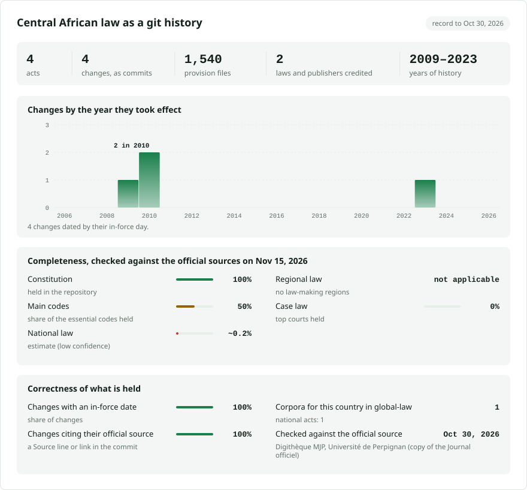

# Central African Republic: law history in git

[Français](README.md) · **English**

<picture>
<source media="(prefers-color-scheme: dark)" srcset="data/effort-dark.svg">

</picture>

The law of the Central African Republic as a git history: one file per article, each version committed on the day it took effect, and the act that made each change as the commit's author (the publisher where no act is credited). `git blame` names who is credited with every paragraph; `git log` lists every change to an article; picking a date gives the text in force that day.

Part of [lexifina/global-law](https://github.com/lexifina/global-law), one git history for every country's law: this is the Central African Republic's national law, which global-law reads at `central-african-republic/national/acts/`.

**What is in it now:** 28 texts, each as its source publishes it: the Constitution of 2023, 11 codes (among them the Code pénal, the Code de procédure pénale and the Code du travail), 4 laws, 4 ordinances, 6 decrees and 1 orders (arrêtés), filed by kind and year ([STRUCTURE.md](STRUCTURE.md); the full list is [`corpus.json`](corpus.json)); 1 earlier constitutional texts (`constitution/anterieures/`); 3 CEMAC community texts that apply in the Central African Republic (`cemac/`). Court decisions (OHADA) are in a separate repository.

Each act is a folder with one file per article: `constitution/`, codes in `codes/<code>/`, other texts by kind and year (`lois/2006/…`, `decrets/2010/…`); so `codes/code-du-travail/art-280.md` is Article 280 of the Code du travail, the right to paid annual leave; the Constitution's preamble is `constitution/preamble.md`.

The text is in French, as its sources print it, spelling and typographical slips included. An English translation is not part of this record.

## Questions as git commands

| Question | Command |
| --- | --- |
| Every change to Article 280 of the Code du travail (paid annual leave) | `git log -p --word-diff -- codes/code-du-travail/art-280.md` |
| Who is credited with each line of Article 280? | `git blame codes/code-du-travail/art-280.md` |
| Every version of the Code du travail, with the day each took effect | `git log --format="%h %(trailers:key=In-force,valueonly,separator=) %an" -- "codes/code-du-travail/art-*.md"` |
| Article 280 as in force on 1 January 2020 | `python tools/on.py 2020-01-01 codes/code-du-travail 280` |

**Outside git**, we also host this record publicly, for free:

- **[Ask Claude about the law of the Central African Republic](https://global-law.lexifina.com/v1/try_claude?country=central-african-republic)**: opens Claude with a first question ready.
- **[Ask ChatGPT](https://global-law.lexifina.com/v1/try_chatgpt?country=central-african-republic)**: the same question in ChatGPT.
- **[Search the law of the Central African Republic on our site](https://lexifina.com/law?country=central-african-republic&q=cong%C3%A9+pay%C3%A9)**: a search for "congé payé" (paid leave), with each provision's text and its versions, no account needed.
- **[Developer REST API](https://global-law.lexifina.com/v1/search_law?query=cong%C3%A9+pay%C3%A9&jurisdiction=central-african-republic)**: the same search as JSON, with no key. See the [documentation here](https://lexifina.com/api/global-law).

Both assistants read the record through the free Global law connector (MCP, `https://global-law.lexifina.com/mcp`); the first time, the chat gives you the link that adds it. Ask in French or in English.

**Host it yourself easily.** All it takes is git and Python, and the tools run on your machine:

```sh
git clone --depth 1 https://github.com/lexifina/global-law && cd global-law
python3 tools/countries.py add central-african-republic/national/acts
python3 tools/law.py show 2026-01-01 central-african-republic/national/acts/codes/code-du-travail/art-280.md
```

Opened in Claude Code, Cursor, VS Code or Codex, the clone also starts a local MCP server with the same tools ([MCP.md](https://github.com/lexifina/global-law/blob/main/MCP.md)).

## Dates

Each commit is dated at noon, Africa/Bangui (UTC+1), on the day the version took effect, and carries it in its `In-force:` trailer:

- the Constitution: 30 August 2023, the day it was promulgated after the referendum of 30 July 2023; it was published in the Journal officiel (special issue no 9) on 4 September 2023;
- each code: the date of the law that enacted it (29 January 2009 for the Code du travail, 6 January 2010 for the Code pénal and the Code de procédure pénale). The last article of each law only orders its publication in the Journal officiel, so the law's own date is used;
- the other texts: the date of the text (promulgation or signature) in its title, or failing that the date of the text in its FAOLEX record (`In-force-basis` trailer); these sources do not give the Journal officiel day; before 1970 the commit is dated 1 January 1970 and the real day is in the subject and in `In-force`. These texts are credited to themselves (for example `Loi n° 06.001 du 12 avril 2006`).

The Constitution is credited to itself (`Constitution of 30 August 2023`). Each code is the oldest version available as text, so it is credited to the publisher, not to a law; all three commits name `Digithèque MJP, Université de Perpignan (copy of the Journal officiel)`, although the codes' text comes from WIPO Lex, FAOLEX and Equipo Nizkor (see [Sources](#sources)). The committer is always Lexifina.

## How it is checked

- `tools/check_repo.py` reads every version back from git on the day it took effect and on the day before, and both must match the corpus the history was built from; it also checks that every commit's trailers parse, that there are no merge commits and that no commit is dated in the future.
- `tools/build.py` writes the history from that corpus in one pass; a second build into an empty folder gave identical hashes. The results are in [`REPRODUCE.md`](REPRODUCE.md), and [`data/corpus.sha256`](data/corpus.sha256) gives the corpus's hash. That corpus covers only the first four texts; the texts added from 27 November 2026 are added by the runner described in [`REPRODUCE.md`](REPRODUCE.md).
- The words are the sources' own, only split into files and lines (see [`LICENSE`](LICENSE)). The Code du travail's paragraphs are rebuilt from the layout of its two-column print; the Code pénal's source marks no paragraph breaks, so each of its articles is one paragraph.
- [vulnerabilities/](vulnerabilities/README.en.md): possible drafting mistakes in this law, found by global-law's detectors and checked by hand. Not run yet.

## What it does not show

- **Any amendment.** The three codes are the texts as enacted in 2009 and 2010; later amendments are not applied, so for any later day this record gives the enacted text.
- **Earlier constitutions** (2016, 2004).
- **Much of Central African law.** The Journal officiel, the Secrétariat général du gouvernement, the Assemblée nationale and the Cour constitutionnelle have no site that answers, so the texts come from the ministries' sites (*.gouv.cf) where they publish them, otherwise from secondary copies (FAOLEX, WIPO Lex). Texts published only as scans (146 so far) are left out: no OCR is done here; a text layer supplied by the publisher is taken (4 texts, trailer `Text-source: publisher OCR`, not proofread). Also missing: the Code de la famille (loi n° 97.013: the only official copy, on justice.gouv.cf, is a scan without a text layer).
- **Amendments to the other texts**: each text is given as its source publishes it; amending laws are separate texts and are not applied to the text they amend.
- **An official copy.** Every text is a third-party copy of the Journal officiel (the Code de procédure pénale a transcription of it); the Journal officiel issue of the Code pénal was not seen.
- **Headings** (titres, chapitres, sections) are not in the article files, nor are the codes' promulgation formulas and signatures.

## Sources

| Source | Kind | Past versions | Notes |
| --- | --- | --- | --- |
| [Digithèque MJP](https://mjp.univ-perp.fr/constit/cf2023.htm) (Jean-Pierre Maury, Université de Perpignan) | Copy of the Constitution from the Journal officiel (special issue no 9, 4 September 2023) | no, the 2023 text only | The Constitution |
| [WIPO Lex](https://wipolex-res.wipo.int/edocs/lexdocs/laws/fr/cf/cf003fr.pdf) (record CF003) | Copy of loi n° 10.001 | no, as enacted | The Code pénal |
| [FAOLEX](https://faolex.fao.org/docs/pdf/caf158592.pdf) (FAO) | The Journal officiel, special edition of 7 September 2010, as a PDF | no, as enacted | The Code du travail |
| [Equipo Nizkor](https://www.derechos.org/intlaw/doc/caf2.html) | Transcription of the Journal officiel, special edition of 15 January 2010 | no, as enacted | The Code de procédure pénale |
| [FAOLEX](https://www.fao.org/faolex/) (FAO) | PDF copies of the published texts, with their text layer | no | The other codes, laws, ordinances, decrees and orders; secondary copy (`Source-status` trailer); non-commercial reuse with credit to FAO |
| [WIPO Lex](https://www.wipo.int/wipolex/) (WIPO) | PDF copies of a few laws | no | Secondary copy (`Source-status` trailer) |
| Ministry sites (finances.gouv.cf, justice.gouv.cf, mines.gouv.cf, …) | Official PDFs published by the ministries | no | Official texts; scans without a text layer left out |
| [CEMAC](https://www.cemac.int) (Commission media library) | Treaty, regulations, directives and additional acts | no | Community law, `cemac/` folder |

## Licence

See [`LICENSE`](LICENSE). The Central African Republic applies Annex VII of the Bangui Agreement (OAPI), whose Article 6(i) excludes official texts of a legislative nature from copyright protection, so none of these texts carries copyright. The arrangement, tables, commit messages and tools are by Lexifina, under CC0 1.0.

No AI model wrote, translated or corrected legal text, and none runs when the history is built; the scripts were written by an AI model (see [`REPRODUCE.md`](REPRODUCE.md)).

## Visualisations

- [visualisations/](visualisations/README.en.md): charts drawn from this repository. Not drawn yet.

## More

From [lexifina/global-law](https://github.com/lexifina/global-law):

- [FEATURES.md](https://github.com/lexifina/global-law/blob/main/FEATURES.md): every feature, and what every corpus must support (`git blame`, `law.py`, the MCP tools)
- [FAQ.md](https://github.com/lexifina/global-law/blob/main/FAQ.md): questions and answers · [CONTRIBUTING.md](https://github.com/lexifina/global-law/blob/main/CONTRIBUTING.md): proposing changes · [MCP.md](https://github.com/lexifina/global-law/blob/main/MCP.md): the MCP server · [REPRODUCE.md](https://github.com/lexifina/global-law/blob/main/REPRODUCE.md): how it was built · [CHANGELOG.md](https://github.com/lexifina/global-law/blob/main/CHANGELOG.md)
- [FRESHNESS.md](https://github.com/lexifina/global-law/blob/main/FRESHNESS.md): how current each corpus is · [Monitoring](https://github.com/lexifina/global-law/tree/main/monitoring): whether updates are running · [WATCHING.md](https://github.com/lexifina/global-law/blob/main/WATCHING.md): how each official source is watched for changes
- [performance/](https://github.com/lexifina/global-law/tree/main/performance): how fast the tools are, measured
- [visualisations/](https://github.com/lexifina/global-law/tree/main/visualisations): charts and bridges across the world's law
- [Vulnerabilities](https://github.com/lexifina/global-law/tree/main/vulnerabilities): mistakes in legislation as published
