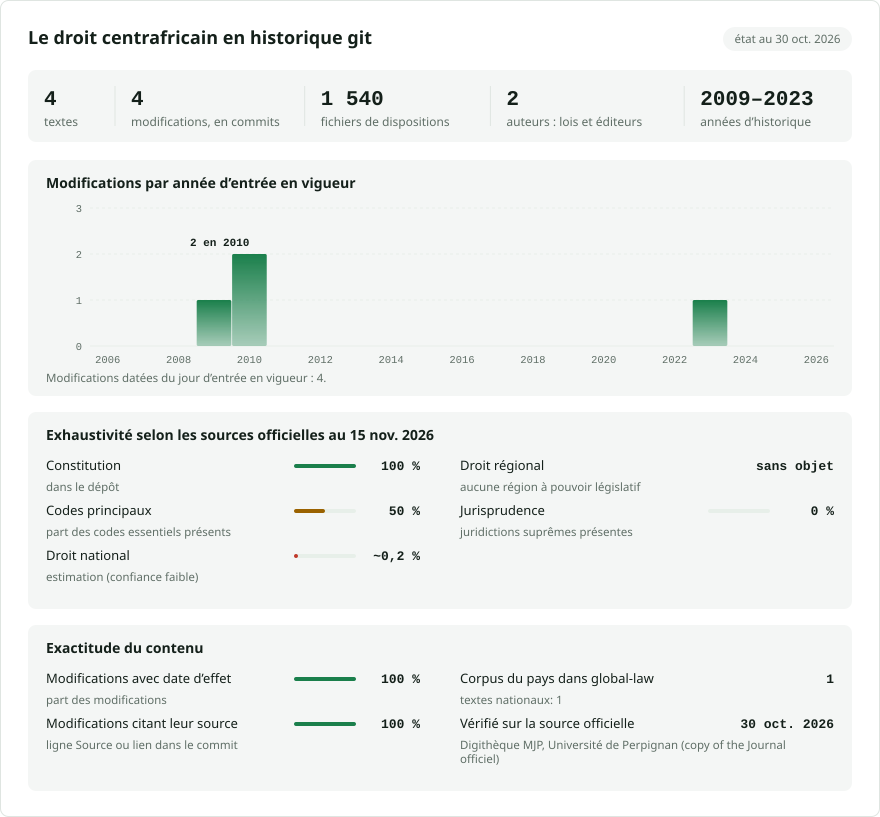

# République centrafricaine : l’historique du droit dans git

**Français** · [English](README.en.md)

<picture>
<source media="(prefers-color-scheme: dark)" srcset="data/fr/effort-dark.svg">

</picture>

Le droit de la République centrafricaine sous forme d’historique git : un fichier par article, chaque version enregistrée au jour de son entrée en vigueur, et pour auteur de chaque commit le texte qui a apporté la modification (l’éditeur lorsqu’aucun texte n’est crédité). `git blame` désigne à qui est attribué chaque alinéa ; `git log` énumère toutes les modifications d’un article ; le choix d’une date donne le texte en vigueur ce jour-là.

Fait partie de [lexifina/global-law](https://github.com/lexifina/global-law), un historique git unique pour le droit de chaque pays : ce dépôt contient le droit national de la République centrafricaine, que global-law lit dans `central-african-republic/national/acts/`.

**Contenu actuel :** 28 textes, chacun dans la version que publie sa source : la Constitution de 2023, 11 codes (dont le Code pénal, le Code de procédure pénale et le Code du travail), 4 lois, 4 ordonnances, 6 décrets et 1 arrêtés, rangés par nature et par année ([STRUCTURE.md](STRUCTURE.md) ; liste complète dans [`corpus.json`](corpus.json)) ; 1 textes constitutionnels antérieurs (`constitution/anterieures/`) ; 3 textes communautaires de la CEMAC applicables en Centrafrique (`cemac/`). Les décisions de justice (OHADA) sont dans un dépôt séparé.

Chaque texte est un dossier comportant un fichier par article : `constitution/`, les codes dans `codes/<code>/`, les autres textes par nature et par année (`lois/2006/…`, `decrets/2010/…`) ; ainsi `codes/code-du-travail/art-280.md` est l’article 280 du Code du travail, relatif au droit au congé annuel payé ; le préambule de la Constitution est `constitution/preamble.md`.

Le texte est en français, tel que l’impriment ses sources, fautes d’orthographe et coquilles comprises. Une traduction anglaise ne fait pas partie de ce registre.

## Questions sous forme de commandes git

| Question | Commande |
| --- | --- |
| Toutes les modifications de l’article 280 du Code du travail (congé annuel payé) | `git log -p --word-diff -- codes/code-du-travail/art-280.md` |
| À qui est attribuée chaque ligne de l’article 280 ? | `git blame codes/code-du-travail/art-280.md` |
| Toutes les versions du Code du travail, avec le jour d’entrée en vigueur de chacune | `git log --format="%h %(trailers:key=In-force,valueonly,separator=) %an" -- "codes/code-du-travail/art-*.md"` |
| L’article 280 tel qu’en vigueur le 1er janvier 2020 | `python tools/on.py 2020-01-01 codes/code-du-travail 280` |

**En dehors de git**, nous hébergeons aussi ce registre publiquement, gratuitement :

- **[Interroger Claude sur le droit de la République centrafricaine](https://global-law.lexifina.com/v1/try_claude?country=central-african-republic)** : ouvre Claude avec une première question prête.
- **[Interroger ChatGPT](https://global-law.lexifina.com/v1/try_chatgpt?country=central-african-republic)** : la même question dans ChatGPT.
- **[Rechercher dans le droit de la République centrafricaine sur notre site](https://lexifina.com/law?country=central-african-republic&q=cong%C3%A9+pay%C3%A9)** : une recherche de « congé payé », avec le texte de chaque disposition et ses versions, sans compte.
- **[API REST pour les développeurs](https://global-law.lexifina.com/v1/search_law?query=cong%C3%A9+pay%C3%A9&jurisdiction=central-african-republic)** : la même recherche en JSON, sans clé. Voir la [documentation ici](https://lexifina.com/api/global-law).

Les deux assistants lisent le registre au moyen du connecteur gratuit Global law (MCP, `https://global-law.lexifina.com/mcp`) ; la première fois, la conversation vous donne le lien qui l’ajoute. Posez vos questions en français ou en anglais.

**L’héberger vous-même, simplement.** Il suffit de git et de Python, et les outils s’exécutent sur votre machine :

```sh
git clone --depth 1 https://github.com/lexifina/global-law && cd global-law
python3 tools/countries.py add central-african-republic/national/acts
python3 tools/law.py show 2026-01-01 central-african-republic/national/acts/codes/code-du-travail/art-280.md
```

Ouvert dans Claude Code, Cursor, VS Code ou Codex, le clone lance aussi un serveur MCP local doté des mêmes outils ([MCP.md](https://github.com/lexifina/global-law/blob/main/MCP.md)).

## Dates

Chaque commit est daté à midi, heure de Bangui (Africa/Bangui, UTC+1), du jour où la version est entrée en vigueur, et porte ce jour dans son trailer `In-force:` :

- la Constitution : le 30 août 2023, jour de sa promulgation à la suite du référendum du 30 juillet 2023 ; elle a été publiée au Journal officiel (numéro spécial n° 9) le 4 septembre 2023 ;
- chaque code : la date de la loi qui l’a adopté (le 29 janvier 2009 pour le Code du travail, le 6 janvier 2010 pour le Code pénal et le Code de procédure pénale). Le dernier article de chaque loi se borne à en ordonner la publication au Journal officiel ; la date de la loi elle-même est donc retenue ;
- les autres textes : la date du texte (promulgation ou signature) que donne son intitulé, ou à défaut la date du texte qu’indique la fiche FAOLEX (trailer `In-force-basis`) ; ces sources ne donnent pas le jour de publication au Journal officiel ; avant 1970, le commit est daté du 1er janvier 1970 et le vrai jour figure dans l’objet et dans `In-force`. Ces textes sont attribués à eux-mêmes (par exemple `Loi n° 06.001 du 12 avril 2006`).

La Constitution est attribuée à elle-même (`Constitution of 30 August 2023`). Chaque code est la plus ancienne version disponible sous forme de texte ; il est donc attribué à l’éditeur, et non à une loi ; les trois commits nomment `Digithèque MJP, Université de Perpignan (copy of the Journal officiel)`, bien que le texte des codes provienne de WIPO Lex, de FAOLEX et d’Equipo Nizkor (voir [Sources](#sources)). Le committer est toujours Lexifina.

## Comment il est vérifié

- `tools/check_repo.py` relit chaque version depuis git au jour de son entrée en vigueur et la veille, et les deux doivent correspondre au corpus à partir duquel l’historique a été construit ; il vérifie aussi que les trailers de chaque commit se lisent sans erreur, qu’il n’existe aucun commit de fusion et qu’aucun commit n’est daté dans le futur.
- `tools/build.py` écrit l’historique à partir de ce corpus en une seule passe ; une seconde construction dans un dossier vide a donné des empreintes identiques. Les résultats figurent dans [`REPRODUCE.md`](REPRODUCE.md), et [`data/corpus.sha256`](data/corpus.sha256) donne l’empreinte du corpus. Ce corpus ne couvre que les quatre premiers textes ; les textes ajoutés depuis le 27 novembre 2026 le sont par le programme décrit dans [`REPRODUCE.md`](REPRODUCE.md).
- Les termes sont ceux des sources elles-mêmes, seulement répartis en fichiers et en lignes (voir [`LICENSE`](LICENSE)). Les alinéas du Code du travail sont reconstitués à partir de la mise en page de son impression sur deux colonnes ; la source du Code pénal ne marque aucun saut d’alinéa, de sorte que chacun de ses articles forme un seul alinéa.
- [vulnerabilities/](vulnerabilities/): erreurs de rédaction possibles dans ce droit, trouvées par les détecteurs de global-law et vérifiées à la main. Pas encore lancé.

## Ce qu’il ne montre pas

- **Aucune modification.** Les trois codes sont les textes tels qu’adoptés en 2009 et 2010 ; les modifications ultérieures ne sont pas appliquées, de sorte que pour tout jour ultérieur ce registre donne le texte adopté.
- **Les constitutions antérieures** (2016, 2004).
- **Une grande partie du droit centrafricain.** Le Journal officiel, le Secrétariat général du gouvernement, l’Assemblée nationale et la Cour constitutionnelle n’ont pas de site qui réponde ; les textes viennent des sites des ministères (*.gouv.cf) quand ils les publient, sinon de copies secondaires (FAOLEX, WIPO Lex). Les textes publiés seulement en numérisation (146 à ce jour) sont écartés : aucune OCR n’est faite ici ; une couche texte fournie par l’éditeur est reprise (4 textes, trailer `Text-source: publisher OCR`, non relue). Manque aussi le Code de la famille (loi n° 97.013 : la seule copie officielle, sur justice.gouv.cf, est une numérisation sans couche texte).
- **Les modifications des autres textes** : chaque texte est donné dans la version publiée par sa source ; les lois modificatives sont des textes distincts et ne sont pas appliquées au texte modifié.
- **Un exemplaire officiel.** Chaque texte est une copie du Journal officiel faite par un tiers (pour le Code de procédure pénale, une transcription de celui-ci) ; le numéro du Journal officiel contenant le Code pénal n’a pas été consulté.
- **Les intitulés** (titres, chapitres, sections) ne figurent pas dans les fichiers des articles, pas plus que les formules de promulgation et les signatures des codes.

## Sources

| Source | Nature | Versions antérieures | Remarques |
| --- | --- | --- | --- |
| [Digithèque MJP](https://mjp.univ-perp.fr/constit/cf2023.htm) (Jean-Pierre Maury, Université de Perpignan) | Copie de la Constitution d’après le Journal officiel (numéro spécial n° 9, 4 septembre 2023) | non, le seul texte de 2023 | La Constitution |
| [WIPO Lex](https://wipolex-res.wipo.int/edocs/lexdocs/laws/fr/cf/cf003fr.pdf) (notice CF003) | Copie de la loi n° 10.001 | non, tel qu’adopté | Le Code pénal |
| [FAOLEX](https://faolex.fao.org/docs/pdf/caf158592.pdf) (FAO) | Le Journal officiel, édition spéciale du 7 septembre 2010, en PDF | non, tel qu’adopté | Le Code du travail |
| [Equipo Nizkor](https://www.derechos.org/intlaw/doc/caf2.html) | Transcription du Journal officiel, édition spéciale du 15 janvier 2010 | non, tel qu’adopté | Le Code de procédure pénale |
| [FAOLEX](https://www.fao.org/faolex/) (FAO) | Copies PDF des textes publiés, avec leur couche texte | non | Les autres codes, lois, ordonnances, décrets et arrêtés ; copie secondaire (trailer `Source-status`) ; réutilisation non commerciale avec mention de la FAO |
| [WIPO Lex](https://www.wipo.int/wipolex/) (OMPI) | Copies PDF de quelques lois | non | Copie secondaire (trailer `Source-status`) |
| Sites des ministères (finances.gouv.cf, justice.gouv.cf, mines.gouv.cf, …) | PDF officiels publiés par les ministères | non | Textes officiels ; numérisations sans couche texte écartées |
| [CEMAC](https://www.cemac.int) (médiathèque de la Commission) | Traité, règlements, directives et actes additionnels | non | Droit communautaire, dossier `cemac/` |

## Licence

Voir [`LICENSE`](LICENSE). La République centrafricaine applique l’annexe VII de l’Accord de Bangui (OAPI), dont l’article 6.i) exclut de la protection par le droit d’auteur les textes officiels de nature législative ; aucun de ces textes n’est donc protégé par le droit d’auteur. L’agencement, les tableaux, les messages de commit et les outils sont l’œuvre de Lexifina, sous CC0 1.0.

Aucun modèle d’IA n’a écrit, traduit ou corrigé de texte juridique, et aucun n’est exécuté lors de la construction de l’historique ; les scripts ont été écrits par un modèle d’IA (voir [`REPRODUCE.md`](REPRODUCE.md)).

Ceci est une traduction de la version anglaise ([README.en.md](README.en.md)) ; en cas de divergence, la version anglaise fait foi.

## Visualisations

- [visualisations/](visualisations/): graphiques tirés de ce dépôt. Pas encore dessinés.

## En savoir plus

Dans le dépôt [lexifina/global-law](https://github.com/lexifina/global-law) (pages en anglais) :

- [FEATURES.md](https://github.com/lexifina/global-law/blob/main/FEATURES.md): toutes les fonctionnalités et ce que chaque corpus doit prendre en charge (`git blame`, `law.py`, outils MCP)
- [FAQ.md](https://github.com/lexifina/global-law/blob/main/FAQ.md): questions et réponses · [CONTRIBUTING.md](https://github.com/lexifina/global-law/blob/main/CONTRIBUTING.md): proposer une modification · [MCP.md](https://github.com/lexifina/global-law/blob/main/MCP.md): serveur MCP · [REPRODUCE.md](https://github.com/lexifina/global-law/blob/main/REPRODUCE.md): comment il a été construit · [CHANGELOG.md](https://github.com/lexifina/global-law/blob/main/CHANGELOG.md)
- [FRESHNESS.md](https://github.com/lexifina/global-law/blob/main/FRESHNESS.md): à quel point chaque corpus est à jour · [Surveillance](https://github.com/lexifina/global-law/tree/main/monitoring): si les mises à jour fonctionnent · [WATCHING.md](https://github.com/lexifina/global-law/blob/main/WATCHING.md): comment chaque source officielle est surveillée pour repérer les modifications
- [performance/](https://github.com/lexifina/global-law/tree/main/performance): la rapidité des outils, mesurée
- [visualisations/](https://github.com/lexifina/global-law/tree/main/visualisations): graphiques et liens à travers le droit du monde entier
- [Vulnérabilités](https://github.com/lexifina/global-law/tree/main/vulnerabilities): erreurs dans les textes tels qu’ils ont été publiés
